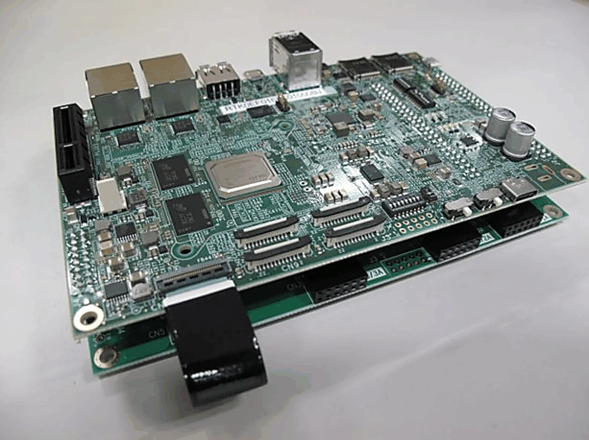
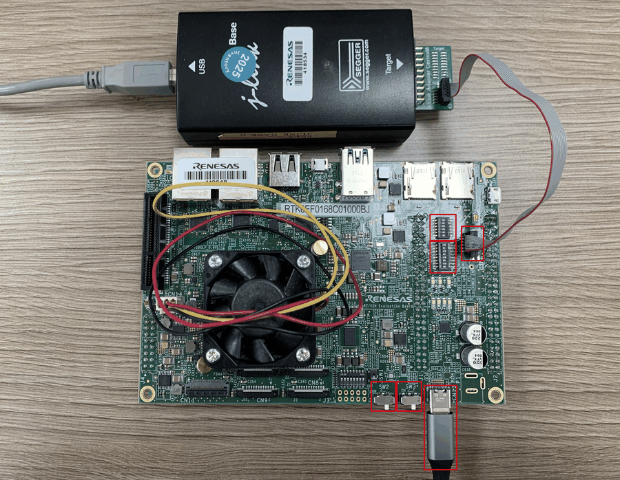

=========
RZV2H-EVK
=========

.. tags:: arch:arm, arch:armv7-r, arch:cortex-r8, chip:rzv2h, vendor:renesas

The RZV2H-EVK is an evaluation board for the Renesas RZ/V2H (R9A09G057)
MPU. NuttX is ported to run on one of the two Cortex-R8 real-time cores
(``CR8_0``).

Board Overview
===============

See the `RZ/V2H product page
<https://www.renesas.com/en/design-resources/boards-kits/rz-v2h-evk#overview>`_
for information about the RZ/V2H MPU.

Board Set-up
============

The following steps set up the board to debug/run NuttX over SWD with a
J-Link debugger:

1. Configure the SWD interface to use the J-Link debugger via the DIP
   switches (highlighted in red in the picture above):

   =====  ===  =====  ===
   DSW 1  Set  DSW 2  Set
   =====  ===  =====  ===
   1-1    ON   2-1    OFF
   1-2    OFF  2-2    OFF
   1-3    ON   2-3    OFF
   1-4    OFF  2-4    OFF
   1-5    ON   2-5    OFF
   1-6    OFF  2-6    OFF
   1-7    ON
   1-8    OFF
   =====  ===  =====  ===

2. Connect CN1 to the J-Link debugger.

3. Make sure SW2 and SW3 are OFF before connecting CN13 to the power
   supply.

4. After CN13 is connected to the power supply, turn SW3 ON first, then
   turn SW2 ON.

To power off the board, reverse the order: disconnect the J-Link debugger
first, then turn SW2 OFF, then SW3 OFF, and only then remove power.

Getting the Renesas HAL
=======================

Clock bring-up (see below) is implemented on top of Renesas' vendored FSP
BSP code, which ships in a separate ``hal_renesas`` repository and is
**not** part of the ``nuttx`` git tree. It must be cloned as a sibling of
the ``nuttx`` and ``apps`` directories before configuring/building this
board:

.. code-block:: bash

   cd nuttxspace   # parent directory of nuttx/ and apps/
   git clone https://github.com/renesas/hal_renesas.git external/hal_renesas

``make context`` (run automatically as part of a normal build) then copies
the pieces it needs from ``external/hal_renesas`` into
``arch/arm/src/rzv2h/hal_renesas`` via the ``hal_cp`` target defined in
``arch/arm/src/rzv2h/Make.defs``. Without this step the build fails with
missing ``bsp_api.h``/FSP header errors.

Buttons and LEDs
================

Buttons
-------

The RZ/V2H-EVK has no dedicated user button.  The board port reserves
``P8_2`` for one external, active-high button and exposes it through the
generic NuttX GPIO interface as ``/dev/gpio0``.  It does not currently
provide a discrete NuttX button device such as ``/dev/buttons``.

Hardware connection
~~~~~~~~~~~~~~~~~~~

Locate ``P8_2`` on the selected expansion connector using the RZ/V2H-EVK
schematic.  Connect a normally-open momentary switch between ``P8_2`` and
the board's 3.3-V logic supply, with a common ground between the board and
the external circuit.  The board configures ``P8_2`` as an input with its
internal pull-down enabled:

* button released: the pull-down drives the input low; ``/dev/gpio0`` reads
  ``0``;
* button pressed: the switch drives the input high; ``/dev/gpio0`` reads
  ``1``.

The pin definition is ``BOARD_P8_2_BUTTON`` in
``boards/arm/rzv2h/rzv2h-evk/include/board.h``.  It selects
``BSP_IO_PORT_08_PIN_02`` with input, input-buffer, and pull-down settings.

.. warning::

   ``P8_2`` is a multiplexed pin.  Confirm the EVK schematic and make sure
   that no enabled peripheral claims this pin before connecting the button.

Configuration and registration
~~~~~~~~~~~~~~~~~~~~~~~~~~~~~~

Use a configuration that enables the generic GPIO test path, for example
``rzv2h-evk:nsh-leds``.  The required options are::

   CONFIG_DEV_GPIO=y
   CONFIG_RZV2H_GPIO=y
   CONFIG_EXAMPLES_GPIO=y
   CONFIG_BOARD_LATE_INITIALIZE=y

During ``board_late_initialize()``, ``rzv2h_bringup()`` calls
``rzv2h_gpio_initialize()``.  This registers the one input first as
``/dev/gpio0`` and configures the input through the Renesas FSP IOPORT
driver.  ``CONFIG_RZV2H_GPIO`` defaults to enabled when ``CONFIG_DEV_GPIO``
is selected, but it is shown above to make the dependency explicit.

NSH usage example
~~~~~~~~~~~~~~~

After booting NuttX, first verify that the device was registered::

   nsh> ls /dev
   nsh> gpio /dev/gpio0
   Driver: /dev/gpio0
     Input pin:     Value=0

Press and hold the button, then run the read command again::

   nsh> gpio /dev/gpio0
   Driver: /dev/gpio0
     Input pin:     Value=1

Release the button and repeat the command; the value must return to ``0``.
Each invocation of the standard ``apps/examples/gpio`` application performs
one read and exits, so the button must remain pressed for the second command.

Current limitations
~~~~~~~~~~~~~~~~~~~

The current GPIO implementation supports synchronous read and write only.
GPIO interrupt attachment and enablement are placeholders, so ``gpio -w``
cannot report button transitions.  Runtime pin-type changes are also not
implemented, so do not use ``gpio -t``.  The board does not debounce the
external switch; use a polling application with software debounce if
continuous monitoring is required.

LEDs
----

Two active-low GPIO outputs are available for LED testing.  They are
registered after the button input, giving the following device mapping:

.. list-table::
   :header-rows: 1

   * - Pin
     - GPIO device
     - Function
   * - ``P0_0``
     - ``/dev/gpio1``
     - LED output 1
   * - ``P0_1``
     - ``/dev/gpio2``
     - LED output 2

Using the NSH GPIO application
~~~~~~~~~~~~~~~~~~~~~~~~~~~~~~

The ``nsh`` configuration enables ``CONFIG_DEV_GPIO`` and
``CONFIG_EXAMPLES_GPIO``.  The ``gpio`` example is reused from the standard
NuttX application repository at ``apps/examples/gpio``; it is not an
RZ/V2H-specific application.  The RZ/V2H board port only configures the pins,
registers ``/dev/gpio0`` through ``/dev/gpio2``, and enables the example in
the board configuration.  The upstream example source is used without
board-specific polling logic.

The GPIO application uses the following command format::

   gpio [-t <pintype>] [-w <signo>] [-o <value>] <driver-path>

.. note::

   At this stage, the RZ/V2H GPIO driver supports only GPIO read and write
   operations for application testing.  Changing the pin type is not
   supported: ``GPIOC_SETPINTYPE`` does not reconfigure the hardware.
   GPIO interrupt attachment and enablement are also placeholders, so
   interrupt notification is not available.

   Consequently, use only ``gpio <driver-path>`` for reading and
   ``gpio -o <0|1> <driver-path>`` for writing.  Do not use the ``-t``
   pin-type option or the ``-w`` interrupt-wait option on this board.

For these LED outputs, only ``-o`` and the device path are needed.  The
``-o`` option writes the logical pin level (zero or one), while the device
path selects the LED.  Because the LEDs are active low, write zero to turn an
LED on and one to turn it off.  For example::

   nsh> gpio -o 0 /dev/gpio1
   nsh> gpio -o 1 /dev/gpio1
   nsh> gpio -o 0 /dev/gpio2
   nsh> gpio -o 1 /dev/gpio2

For each command, the application reports the previous output level, the
level being written, and the level read back from the driver.  For example,
if LED output 1 is currently off::

   nsh> gpio -o 0 /dev/gpio1
   Driver: /dev/gpio1
     Output pin:    Value=1
     Writing:       Value=0
     Verify:        Value=0

Omit ``-o`` to read the current output level without changing it::

   nsh> gpio /dev/gpio1

Each invocation performs a single GPIO operation and then exits.  This is
sufficient for the manual button and LED validation described here.

Use ``gpio -h`` to display the generic application's command syntax.  Some
options shown by that help text are not yet supported by the RZ/V2H GPIO
driver, as described above.

Using the NuttX user-LED application
~~~~~~~~~~~~~~~~~~~~~~~~~~~~~~~~~~~~

The ``nsh-leds`` configuration also enables the standard NuttX user-LED
interface and example with these options::

   # CONFIG_ARCH_LEDS is not set
   CONFIG_USERLED=y
   CONFIG_USERLED_LOWER=y
   CONFIG_EXAMPLES_LEDS=y
   CONFIG_BOARD_LATE_INITIALIZE=y

During late initialization, the board registers ``/dev/userleds``.  The
``board_userled_*()`` callbacks configure ``P0_0`` and ``P0_1``, convert the
logical LED state to the active-low pin level, and support LED mask bits
``0x01`` and ``0x02``.

Run the unmodified NuttX example from ``apps/examples/leds`` to cycle the two
LED outputs::

   nsh> ls /dev
   nsh> leds

The device list should contain ``userleds``, and the example should report a
supported LED mask of ``0x03``.  The ``leds`` command starts a background
``led_daemon`` that cycles the LED mask.  Its startup message prints the
daemon PID; use ``kill <pid>`` to stop it.

This interface is separate from the generic ``/dev/gpio1`` and
``/dev/gpio2`` devices.  Use the ``gpio`` example for individual read/write
validation, or use the ``leds`` example to exercise the NuttX user-LED API.
Automatic OS-status LED control through ``CONFIG_ARCH_LEDS`` is not yet
implemented.

Application test responsibilities
~~~~~~~~~~~~~~~~~~~~~~~~~~~~~~~~~

The current button and LED tests both reuse the standard NuttX GPIO example:

.. list-table::
   :header-rows: 1

   * - Test
     - Application source
     - Responsibility
   * - Button read test
     - Standard NuttX ``apps/examples/gpio`` application
     - Press and hold the button, then read ``/dev/gpio0``
   * - LED read/write test
     - Standard NuttX ``apps/examples/gpio`` application
     - Reused unchanged; the board port only configures and registers the
       LED GPIO devices
   * - User-LED sequence test
     - Standard NuttX ``apps/examples/leds`` application
     - Reused unchanged; it controls both active-low outputs through
       ``/dev/userleds``

.. important::

   No RZ/V2H-specific test application is required for the current manual
   validation.  Use the standard NuttX ``gpio`` example to read the button
   through ``/dev/gpio0`` and to control the LEDs through ``/dev/gpio1`` and
   ``/dev/gpio2``.  A separate polling application is needed only if
   continuous monitoring, transition detection, or debounce testing is
   required later.

   The GPIO devices are registered from the board late-initialization path, so
   ``CONFIG_BOARD_LATE_INITIALIZE`` must remain enabled.

   The user-controlled ``board_userled_*()`` hooks and ``/dev/userleds`` are
   supported.  The automatic ``board_autoled_*()`` hooks selected by
   ``CONFIG_ARCH_LEDS`` remain placeholders.

SPI
===

The RZ/V2H-EVK board logic configures pins and registers the RZ/V2H SPI-B
lower half.  All three channels can be enabled independently.  A channel
selected as master uses the NuttX master interface; a channel selected as
slave uses the separate NuttX slave-controller interface.

Pin Assignments
---------------

The SPI-B channels use the following board-defined pin assignments.  The SSL
column shows the default route selected in
``boards/arm/rzv2h/rzv2h-evk/include/board.h``.  SSL is configured only in
4-wire mode.

.. list-table::
   :header-rows: 1

   * - Channel
     - RSPCK Pin
     - MOSI Pin
     - MISO Pin
     - Default SSL Pin
   * - SPI-B 0
     - ``P9_2``
     - ``P9_0``
     - ``P9_1``
     - ``SSLA0`` on ``P9_3``
   * - SPI-B 1
     - ``PB_0``
     - ``PB_1``
     - ``PB_2``
     - ``SSLB0`` on ``PA_4``
   * - SPI-B 2
     - ``PB_5``
     - ``PB_4``
     - ``PB_3``
     - ``SSLC0`` on ``PA_7``

SSL Route Selection
-------------------

Kconfig selects only 3-wire or 4-wire operation; it does not select an SSL
signal or pin.  For 4-wire operation, each channel's
``BOARD_SPIx_SSL_ROUTE`` definition in ``board.h`` selects one of the
following routes supported by the current pin definitions:

.. list-table::
   :header-rows: 1

   * - Channel
     - SSL Signal
     - Hardware Selector
     - Available Route Definitions
   * - SPI-B 0
     - ``SSLA0``
     - 0
     - ``BOARD_SPI0_SSL_ROUTE_SSLA0_P04`` (``P0_4``),
       ``BOARD_SPI0_SSL_ROUTE_SSLA0_P34`` (``P3_4``),
       ``BOARD_SPI0_SSL_ROUTE_SSLA0_P93`` (``P9_3``)
   * - SPI-B 0
     - ``SSLA1``
     - 1
     - ``BOARD_SPI0_SSL_ROUTE_SSLA1_P05`` (``P0_5``),
       ``BOARD_SPI0_SSL_ROUTE_SSLA1_P35`` (``P3_5``),
       ``BOARD_SPI0_SSL_ROUTE_SSLA1_P94`` (``P9_4``)
   * - SPI-B 0
     - ``SSLA2``
     - 2
     - ``BOARD_SPI0_SSL_ROUTE_SSLA2_P14`` (``P1_4``),
       ``BOARD_SPI0_SSL_ROUTE_SSLA2_P36`` (``P3_6``),
       ``BOARD_SPI0_SSL_ROUTE_SSLA2_P95`` (``P9_5``)
   * - SPI-B 0
     - ``SSLA3``
     - 3
     - ``BOARD_SPI0_SSL_ROUTE_SSLA3_P15`` (``P1_5``),
       ``BOARD_SPI0_SSL_ROUTE_SSLA3_P37`` (``P3_7``),
       ``BOARD_SPI0_SSL_ROUTE_SSLA3_P96`` (``P9_6``)
   * - SPI-B 1
     - ``SSLB0``
     - 0
     - ``BOARD_SPI1_SSL_ROUTE_SSLB0_P34`` (``P3_4``),
       ``BOARD_SPI1_SSL_ROUTE_SSLB0_PA4`` (``PA_4``)
   * - SPI-B 1
     - ``SSLB1``
     - 1
     - ``BOARD_SPI1_SSL_ROUTE_SSLB1_P36`` (``P3_6``),
       ``BOARD_SPI1_SSL_ROUTE_SSLB1_PA5`` (``PA_5``)
   * - SPI-B 1
     - ``SSLB2``
     - 2
     - ``BOARD_SPI1_SSL_ROUTE_SSLB2_P04`` (``P0_4``),
       ``BOARD_SPI1_SSL_ROUTE_SSLB2_PA6`` (``PA_6``)
   * - SPI-B 1
     - ``SSLB3``
     - 3
     - ``BOARD_SPI1_SSL_ROUTE_SSLB3_P14`` (``P1_4``),
       ``BOARD_SPI1_SSL_ROUTE_SSLB3_PA7`` (``PA_7``)
   * - SPI-B 2
     - ``SSLC0``
     - 0
     - ``BOARD_SPI2_SSL_ROUTE_SSLC0_P35`` (``P3_5``),
       ``BOARD_SPI2_SSL_ROUTE_SSLC0_PA7`` (``PA_7``)
   * - SPI-B 2
     - ``SSLC1``
     - 1
     - ``BOARD_SPI2_SSL_ROUTE_SSLC1_P37`` (``P3_7``),
       ``BOARD_SPI2_SSL_ROUTE_SSLC1_PA6`` (``PA_6``)
   * - SPI-B 2
     - ``SSLC2``
     - 2
     - ``BOARD_SPI2_SSL_ROUTE_SSLC2_P05`` (``P0_5``),
       ``BOARD_SPI2_SSL_ROUTE_SSLC2_PA5`` (``PA_5``)
   * - SPI-B 2
     - ``SSLC3``
     - 3
     - ``BOARD_SPI2_SSL_ROUTE_SSLC3_P15`` (``P1_5``),
       ``BOARD_SPI2_SSL_ROUTE_SSLC3_PA4`` (``PA_4``)

To change an SSL route, edit only the applicable default in ``board.h``.  For
example, SPI-B 0 defaults to SSLA0 on P9_3::

   #define BOARD_SPI0_SSL_ROUTE  BOARD_SPI0_SSL_ROUTE_SSLA0_P93

To use SSLA2 on P9_5 instead, change it to::

   #define BOARD_SPI0_SSL_ROUTE  BOARD_SPI0_SSL_ROUTE_SSLA2_P95

The board definitions derive the hardware selector and the master output or
slave input pin from this route.  Do not edit the derived
``BOARD_SPIx_SSL_SELECT``, ``BOARD_SPIx_SSL_INPUT``,
``BOARD_SPIx_SSL_OUTPUT``, or ``BOARD_SPIx_SSL_PIN`` definitions.

Before selecting another route, check the EVK schematic and all enabled
peripherals for pin conflicts.  Some routes share physical pins with routes
on other SPI-B channels or with other peripheral functions.

Configuration
-------------

Start from the dedicated configuration when validating SPI::

   tools/configure.sh rzv2h-evk:nsh-spi
   make

The configuration enables the following common options::

   CONFIG_NSH_MAXARGUMENTS=32
   CONFIG_SPI=y
   CONFIG_SPI_EXCHANGE=y
   CONFIG_SPI_DRIVER=y
   CONFIG_SPI_SLAVE=y
   CONFIG_SPI_SLAVE_DRIVER=y
   CONFIG_EXAMPLES_SPISLV=y
   CONFIG_SYSTEM_SPITOOL=y
   CONFIG_RZV2H_SPI_B=y
   CONFIG_RZV2H_SPI_B_IRQ_PRIORITY=12

For each required channel, enable ``CONFIG_RZV2H_SPI_CHANNEL_0``,
``CONFIG_RZV2H_SPI_CHANNEL_1``, or ``CONFIG_RZV2H_SPI_CHANNEL_2`` and choose:

* its initial frequency and word width;
* CPOL and CPHA;
* the master or slave operating role;
* 3-wire clock-synchronous or 4-wire SPI operation;
* RXI and TXI interrupt-select numbers.

The role and wire mode are compile-time choices.  ``CONFIG_SPI_DRIVER``
registers each master channel as ``/dev/spiN`` and
``CONFIG_SPI_SLAVE_DRIVER`` registers each slave channel as
``/dev/spislvN``, where ``N`` is the SPI-B hardware channel.  ``spitool``
uses only the master interface.  The ``spislv`` example accesses the generic
SPI slave character driver.

Initialization
--------------

During late board initialization, ``rzv2h_bringup()`` calls
``board_spi_initialize()`` when ``CONFIG_RZV2H_SPI_B`` is enabled.  For each
enabled channel, the board layer performs the following operations:

#. Configures MISO, MOSI, and RSPCK through the FSP IOPORT API.  In 4-wire
   mode, it also configures SSL as a native SPI-B peripheral output for a
   master or input for a slave.  SSL is left unconfigured in 3-wire mode.
#. Calls ``rzv2h_spibus_initialize()`` for a master or
   ``rzv2h_spi_slave_initialize()`` for a slave.
#. Connects RXI and TXI events to their configured INTSEL lines, attaches the
   NuttX handlers, and configures the fixed TEI and ERI interrupts.
#. Registers a master with ``spi_register()`` or a slave with
   ``spi_slave_register()``.  The slave FSP instance is opened when its
   upper half binds so the requested mode and word width can be applied.

An initialization failure is reported through syslog and causes board
bring-up to return the corresponding error.  Verify registration after boot::

   nsh> ls /dev

The expected list contains ``spiN`` for each master and ``spislvN`` for each
slave.  By default, ``nsh-spi`` registers ``/dev/spi0``, ``/dev/spi1``, and
``/dev/spislv2``.

Interrupt routing
-----------------

RXI and TXI use programmable SEL lines.  Their defaults are:

.. list-table::
   :header-rows: 1

   * - Channel
     - TXI option and default
     - RXI option and default
   * - 0
     - ``CONFIG_RZV2H_SPI0_TXI_INTSEL=428``
     - ``CONFIG_RZV2H_SPI0_RXI_INTSEL=427``
   * - 1
     - ``CONFIG_RZV2H_SPI1_TXI_INTSEL=426``
     - ``CONFIG_RZV2H_SPI1_RXI_INTSEL=425``
   * - 2
     - ``CONFIG_RZV2H_SPI2_TXI_INTSEL=424``
     - ``CONFIG_RZV2H_SPI2_RXI_INTSEL=423``

Do not assign one SEL interrupt to more than one event.  TEI and ERI do not
have Kconfig selectors because SPI-B gives them fixed interrupt assignments.
All four NuttX handlers enter the corresponding FSP ISR.  RXI, TXI, and TEI
use rising-edge triggers; ERI uses a high-level trigger.

Runtime API behavior
--------------------

``SPI_SETFREQUENCY()`` asks FSP to calculate a divider and returns the actual
clock, which does not exceed the requested master frequency.  Requests above
the hardware maximum select the maximum supported rate.  The lower half
reopens the FSP instance to apply frequency or CPOL/CPHA changes.

On a master, ``SPI_SETMODE()`` supports modes 0 through 3 and
``SPI_SETBITS()`` accepts widths from 4 through 32 bits.  Word width is passed
to each FSP transfer and does not require reopening the instance.  On a slave,
the generic slave upper half supplies mode and width to ``bind()`` through
``CONFIG_SPI_SLAVE_DRIVER_MODE`` and ``CONFIG_SPI_SLAVE_DRIVER_WIDTH``.  The
external master alone supplies the bus clock, so the slave channel's initial
frequency is unused.

FSP wire mode
-------------

Each channel provides a mutually exclusive Kconfig choice:

* ``CONFIG_RZV2H_SPI_CHANNEL_0_3WIRE``,
  ``CONFIG_RZV2H_SPI_CHANNEL_1_3WIRE``, and
  ``CONFIG_RZV2H_SPI_CHANNEL_2_3WIRE`` select
  ``SPI_B_SSL_MODE_CLK_SYN`` for the corresponding channel.  This is the FSP
  clock-synchronous method using MOSI, MISO, and RSPCK without hardware SSL
  framing.  SSL remains unconfigured for both operating roles.
* ``CONFIG_RZV2H_SPI_CHANNEL_0_4WIRE``,
  ``CONFIG_RZV2H_SPI_CHANNEL_1_4WIRE``, and
  ``CONFIG_RZV2H_SPI_CHANNEL_2_4WIRE`` select ``SPI_B_SSL_MODE_SPI``.  This
  uses MOSI, MISO, RSPCK, and SSL.  The selected SSL route is a native SPI-B
  peripheral output for a master or input for a slave.

The 3-wire choice is the Kconfig default.  In 4-wire master mode, FSP and the
SPI-B peripheral assert and deassert the selected SSL signal around a
transfer.  The single board ``select()`` callback recognizes
``SPIDEV_USER(0)`` but does not drive a GPIO: it ignores the request in 3-wire
mode and leaves native SSL framing to SPI-B in 4-wire mode.  The corresponding
master ``status()`` callback reports ``SPI_STATUS_PRESENT`` for
``SPIDEV_USER(0)`` and zero for other device IDs.

The FSP wire-mode setting is separate from the NuttX SPI modes 0 through 3
selected by ``SPI_SETMODE()``.  Those modes control CPOL and CPHA.

Master transfers use FSP asynchronously but block the calling NuttX task
until the FSP completion callback runs.  Slave writes arm an FSP transfer and
return without waiting for master clocks.

Channel 1 master loopback test
------------------------------

The ``nsh-spi`` configuration enables channel 1 as a master with 3-wire
clock-synchronous operation, mode 0, 8-bit words, and an initial frequency of
1 MHz::

   CONFIG_RZV2H_SPI_CHANNEL_1=y
   CONFIG_RZV2H_SPI_CHANNEL_1_MASTER=y
   CONFIG_RZV2H_SPI_CHANNEL_1_3WIRE=y
   CONFIG_RZV2H_SPI_CHANNEL_1_FREQUENCY=1000000
   CONFIG_RZV2H_SPI_CHANNEL_1_NBITS=8
   CONFIG_RZV2H_SPI_CHANNEL_1_CPOL_LOW=y
   CONFIG_RZV2H_SPI_CHANNEL_1_CPHA_ODD=y

With the board powered off, connect channel 1 MOSI ``PB_1`` directly to
channel 1 MISO ``PB_2``.  No SSL connection is required in 3-wire mode.
Channel 1 RSPCK is available on ``PB_0`` for logic-analyzer measurements.

.. warning::

   ``PB_0``, ``PB_1``, and ``PB_2`` are multiplexed with board USB and camera
   control signals.  Do not run a conflicting peripheral while using these
   pins for SPI1, and verify the EVK connection before installing the
   PB_1-to-PB_2 loopback jumper.

After rebuilding and booting NuttX, verify that ``/dev/spi1`` is present and
run::

   nsh> spi exch -b1 -f1000000 -m0 -w8 -x4 AABBCCDD
   Sending:        AA BB CC DD
   Received:       AA BB CC DD

Matching transmitted and received bytes validate the SPI1 pin multiplexing,
master transfer, interrupt dispatch, and completion path.  The SPI clock is
active only while data is transferred.  To measure its frequency, capture a
clock burst on ``PB_0`` and measure between steady-state RSPCK edges rather
than between separate transfers.

Channel 0 master to channel 2 slave test
----------------------------------------

The intended inter-channel wiring is:

.. list-table::
   :header-rows: 1

   * - Channel 0 master
     - Channel 2 slave
   * - MOSI ``P9_0``
     - MOSI ``PB_4``
   * - MISO ``P9_1``
     - MISO ``PB_3``
   * - RSPCK ``P9_2``
     - RSPCK ``PB_5``

For the default 3-wire mode, do not connect channel 0 SSL ``P9_3`` to channel
2 SSL ``PA_7``.  The slave does not use SSL in this mode.  Select 3-wire mode
explicitly when reproducing this setup::

   CONFIG_RZV2H_SPI_CHANNEL_0_3WIRE=y
   CONFIG_RZV2H_SPI_CHANNEL_2_3WIRE=y

For a 4-wire test, select 4-wire mode on both channels and add the SSL
connection::

   CONFIG_RZV2H_SPI_CHANNEL_0_4WIRE=y
   CONFIG_RZV2H_SPI_CHANNEL_2_4WIRE=y

Connect channel 0 SSLA0 ``P9_3`` to channel 2 SSLC0 ``PA_7``.  The board
configures ``P9_3`` as the native SSLA0 peripheral output and ``PA_7`` as the
native SSLC0 peripheral input.

The ``nsh-spi`` configuration already selects channel 0 master, channel 2
slave, mode 0, 8-bit words, the slave character driver, and the ``spislv``
example.

Queue four slave bytes, then clock one four-byte full-duplex transaction from
the master::

   nsh> spislv -p /dev/spislv2 -x 4 AABBCCDD &
   Slave: Queuing 4 bytes for sending to master: AA BB CC DD
   nsh> spi exch -b0 -f1000000 -m0 -w8 -x4 11223344
   Sending:        11 22 33 44
   Data received from master (4 bytes): 11 22 33 44
   Received:       AA BB CC DD

For listen-only validation, set
``CONFIG_RZV2H_SPI_SLAVE_DEFAULT_NWORDS=4`` and run::

   nsh> spislv -p /dev/spislv2 -l &
   Slave: Listen-only mode activated. Waiting for data from master.
   nsh> spi exch -b0 -f1000000 -m0 -w8 -x4 11223349
   Sending:        11 22 33 49
   Data received from master (4 bytes): 11 22 33 49
   Received:       00 00 00 00

The fixed listen length is required because FSP must know the transfer count
before the master supplies clocks.  The all-zero master receive data is
expected because no slave transmit block was queued.  Clocking fewer words
leaves the transfer armed; clocking more words is outside the committed FSP
transaction.

Current limitations
-------------------

* DMA, deferred-trigger transfers, optional hardware-feature control, and
  master callback registration are not implemented.
* Master device-ID mapping supports ``SPIDEV_USER(0)`` only.  Hardware SSL,
  rather than a GPIO write in ``select()``, frames 4-wire transfers.
  ``SPI_B_SSL_LEVEL_KEEP_DISABLE`` means that each FSP transfer has its own
  SSL frame; ``select()`` cannot hold SSL active across multiple transfers.
* A master synchronous transfer has no timeout.
* ``cmddata()`` has no board D/C signal and returns ``-ENOSYS`` for the
  supported device ID.  Runtime delay control accepts only an all-zero delay
  request.
* Both ends of an inter-channel test must use the same CPOL, CPHA, and word
  width.  The master alone determines the bus frequency.

QSPI Flash
==========

The board port drives the xSPI controller in QSPI mode (see
:doc:`the RZV2H peripheral overview <../../index>`) to talk to a SPI NOR
flash device. There is no flash part wired into the NuttX tree for this
board; select the matching ``CONFIG_MTD_*`` driver for the part actually
fitted on the EVK before enabling ``CONFIG_RZV2H_QSPI``.

``rzv2h_qspi_initialize()``
(``boards/arm/rzv2h/rzv2h-evk/src/rzv2h_qspi.c``) brings up the bus,
initializes the selected MTD flash driver, and then either:

- mounts the whole chip as a single flat LittleFS volume at ``/mnt/qspi``
  (default), or
- if ``CONFIG_MTD_PARTITION`` is enabled, splits the chip into three MTD
  partitions first (see Partitioning below), and mounts LittleFS on the
  remaining space only.

Read protocol
-------------

The default read protocol is ``1S-4S-4S``. ``1S-1S-1S``, ``1S-2S-2S``,
and ``4S-4S-4S`` also work on this board. They are selected with the
``CONFIG_RZV2H_QSPI_N25QXXX_PROTOCOL_*`` choice (see
:doc:`the RZV2H peripheral overview <../../index>`).

This board ties ``XSPI0_DS`` to GND through a 10K resistor (R47). It
also leaves ``XSPI0_IO4``-``XSPI0_IO7`` unconnected to the flash. As a
result, the DDR protocols cannot work here:

- Selecting ``CONFIG_RZV2H_QSPI_N25QXXX_PROTOCOL_4S4D4D`` stops the build
  with an ``#error``.
- ``8D-8D-8D`` is not supported.

Partitioning
------------

Enabling ``CONFIG_MTD_PARTITION`` (plus ``CONFIG_MTD_CONFIG`` or
``CONFIG_MTD_CONFIG_NVS``) makes ``rzv2h_qspi_partition()`` divide
the flash chip into three independent regions, so that firmware,
parameters, and logging cannot corrupt one another on the same chip:

.. list-table::
   :header-rows: 1

   * - Partition
     - Size (Kconfig)
     - Exposed as
     - Purpose
   * - Firmware image
     - ``CONFIG_RZV2H_QSPI_FW_PART_SIZE`` (KiB, default 4096)
     - ``/dev/mtdfw0`` (raw MTD, no filesystem)
     - Fixed-offset region for a flight-stack (e.g. PX4) firmware image,
       read/written directly by a bootloader/loader
   * - Parameter/configuration
     - ``CONFIG_RZV2H_QSPI_PARAM_PART_SIZE`` (KiB, default 256)
     - ``/dev/config`` (via ``mtdconfig_register()``)
     - Key/value parameter and configuration store, isolated from
       filesystem I/O
   * - Mission data / flight logs
     - remainder of the chip
     - ``/mnt/qspi`` (LittleFS)
     - Ordinary files: mission data, flight logs, and (optionally) the
       redirected syslog file described below

Both partition sizes are rounded down to a multiple of the flash erase
size. If the requested firmware and parameter partitions do not fit
within the chip's erase-block count, ``rzv2h_qspi_initialize()``
fails with an error logged via ``syslog()``.

When ``CONFIG_MTD_PARTITION`` is disabled, none of the above applies and
the chip is used as a single flat LittleFS volume, as before.

Persistent syslog
------------------

``CONFIG_RZV2H_QSPI_SYSLOG_FILE`` redirects kernel ``syslog()`` output to
a file on the mounted QSPI LittleFS volume (default path
``/mnt/qspi/syslog.txt``, set via ``CONFIG_RZV2H_QSPI_SYSLOG_FILE_PATH``)
once it is mounted, so log messages persist across resets. This requires
``CONFIG_FS_LITTLEFS`` and ``CONFIG_SYSLOG_FILE``. When
``CONFIG_MTD_PARTITION`` is enabled, this file lives in the mission-data
/ flight-log partition described above, not in the firmware or parameter
partitions.

Serial Consoles
===============

The default ``nsh`` configuration uses SCI channel 0 as the serial console
at 115200 baud, 8 data bits, no parity, and one stop bit. The board pin
definitions route SCI0 as follows:

======  ========  =======================
Signal  Pin       Board definition
======  ========  =======================
TXD0    ``P5_0``  ``BOARD_SCI0_TXD_GPIO``
RXD0    ``P5_1``  ``BOARD_SCI0_RXD_GPIO``
======  ========  =======================

Connect the USB-to-UART adapter to the CN3 Pmod contacts shown below:

========  ==========  ========  =========================
CN3 pin   CN3 signal  SoC pin   USB-to-UART connection
========  ==========  ========  =========================
1         CTS         ``P52``   RTS (Unused)
2         TXD0        ``P50``   RX
3         RXD0        ``P51``   TX
4         RTS         ``P53``   CTS (Unused)
5         GND         --        GND
6         VCC         --        VCC
7         IO1         ``P57``   Unused
8         IO2         ``P73``   Unused
9         IO3         ``P76``   Unused
10        IO4         ``P77``   Unused
11        GND         --        Unused
12        VCC         --        Unused
========  ==========  ========  =========================

Cross the data lines so that CN3 TXD0 connects to the adapter RX and CN3
RXD0 connects to the adapter TX. Hardware flow control is not enabled, so
CTS and RTS remain disconnected. Use a 3.3 V TTL UART adapter, not an RS-232
adapter. The table assumes that the adapter is powered through USB; do not
connect either CN3 VCC contact to the adapter.

The relevant default options are::

   CONFIG_RZV2H_UART_SCI=y
   CONFIG_RZV2H_SCI_UART0=y
   CONFIG_SCI0_SERIAL_CONSOLE=y
   CONFIG_SCI0_BAUD=115200
   CONFIG_SCI0_BITS=8
   CONFIG_SCI0_PARITY=0
   CONFIG_SCI0_2STOP=0

After boot, SCI0 is available as both ``/dev/console`` and ``/dev/ttyS0``.
The terminal should display the NuttX banner followed by the ``nsh>`` prompt.
Verify the registration with::

   nsh> ls /dev
   /dev:
    console
    null
    ttyS0
    zero

Additional enabled SCI channels are registered as later ``/dev/ttyS*``
devices in ascending hardware-channel order. Their TX and RX pin choices are
board-specific and are defined by ``BOARD_SCIn_TXD_GPIO`` and
``BOARD_SCIn_RXD_GPIO`` in ``boards/arm/rzv2h/rzv2h-evk/include/board.h``.

Real-Time Clock (RTC)
=====================

The RZ/V2H RTC provides a calendar clock, a one-shot alarm and a periodic
wakeup.  It is registered through ``CONFIG_RTC_ARCH`` so a single driver both
exposes ``/dev/rtc0`` and seeds the NuttX system clock at boot.  If the RTC
has never been set, the system clock falls back to the build-time default
date.

Clock source
------------

On the RZ/V2H-EVK the RTC sub-clock is driven from a 32.768 kHz crystal.
Alarm and periodic wakeup have been verified running on the EVK.

Configuration
-------------

Enable the RTC on top of an existing configuration (for example
``rzv2h-evk:nsh``) with the following options::

   CONFIG_RTC=y
   CONFIG_RTC_DATETIME=y
   CONFIG_RTC_DRIVER=y
   CONFIG_RTC_ARCH=y
   CONFIG_RTC_ALARM=y
   CONFIG_RTC_NALARMS=1
   CONFIG_RTC_PERIODIC=y
   CONFIG_RZV2H_RTC=y
   CONFIG_NSH_DISABLE_DATE=n
   CONFIG_SIG_EVTHREAD=y
   CONFIG_SCHED_LPWORK=y
   CONFIG_EXAMPLES_ALARM=y
   CONFIG_BOARD_LATE_INITIALIZE=y

With these options the board registers ``/dev/rtc0`` during board
initialization.

NSH usage example
-----------------

The following console sessions show how an application/user drives the RTC
from NSH.  The RTC character device is registered as ``/dev/rtc0``:

.. code-block:: console

   nsh> ls /dev
   /dev:
    ...
    rtc0
    ...

Read and set the calendar with the NSH ``date`` builtin
(``CONFIG_NSH_DISABLE_DATE=n``).  If the RTC has never been set, the boot
log reports the fallback and ``date`` shows the build-time default:

.. code-block:: console

   rzv2h_rtc: RTC not set; using build-time default date
   NuttShell (NSH) NuttX-13.0.0
   nsh> date -s "Jul 29 15:30:00 2026"
   nsh> date
   Wed, Jul 29 15:30:01 2026

Arm a relative alarm with the standard ``apps/examples/alarm`` application
(``CONFIG_EXAMPLES_ALARM``).  The example starts an ``alarm_daemon`` on first
use; the daemon prints when the alarm signal is received:

.. code-block:: console

   nsh> alarm 5
   alarm_daemon started
   alarm_daemon: Running
   Opening /dev/rtc0
   Alarm 0 set in 5 seconds
   nsh> alarm_daemon: alarm 0 received

A pending alarm can be read back, and an armed alarm can be cancelled:

.. code-block:: console

   nsh> alarm 30
   Opening /dev/rtc0
   Alarm 0 set in 30 seconds
   nsh> alarm -c -a 0
   Opening /dev/rtc0
   Alarm 0 has been canceled

RIIC I2C
========

The RZV2H-EVK exposes nine RIIC I2C master channels (RIIC0-RIIC8).

Pin Assignments
---------------

Each RIIC channel is routed to the following board pins.

.. list-table::
   :header-rows: 1

   * - Channel
     - SCL Pin
     - SDA Pin
   * - RIIC0
     - ``P3_1``
     - ``P3_0``
   * - RIIC1
     - ``P3_3``
     - ``P3_2``
   * - RIIC2
     - ``P2_1``
     - ``P2_0``
   * - RIIC3
     - ``P3_7``
     - ``P3_6``
   * - RIIC4
     - ``P4_1``
     - ``P4_0``
   * - RIIC5
     - ``P4_3``
     - ``P4_2``
   * - RIIC6
     - ``P4_5``
     - ``P4_4``
   * - RIIC7
     - ``P4_7``
     - ``P4_6``
   * - RIIC8
     - ``P0_7``
     - ``P0_6``

These definitions are in ``boards/arm/rzv2h/rzv2h-evk/include/board.h``.

Default Interrupt Select IDs
-----------------------------

Each RIIC channel uses eight interrupt sources. TXI and RXI are routed
through the programmable INTC interrupt-select (SEL) lines; the remaining
six (TEI, NAKI, SPI, STI, ALI, TMOI) are fixed GIC interrupts.

**TXI / RXI SEL IRQ numbers** (configurable via Kconfig, valid range
353-479):

.. list-table::
   :header-rows: 1

   * - Channel
     - TXI SEL (GIC IRQ)
     - RXI SEL (GIC IRQ)
   * - RIIC0
     - 447 (SEL94)
     - 446 (SEL93)
   * - RIIC1
     - 445 (SEL92)
     - 444 (SEL91)
   * - RIIC2
     - 443 (SEL90)
     - 442 (SEL89)
   * - RIIC3
     - 441 (SEL88)
     - 440 (SEL87)
   * - RIIC4
     - 439 (SEL86)
     - 438 (SEL85)
   * - RIIC5
     - 437 (SEL84)
     - 436 (SEL83)
   * - RIIC6
     - 435 (SEL82)
     - 434 (SEL81)
   * - RIIC7
     - 433 (SEL80)
     - 432 (SEL79)
   * - RIIC8
     - 431 (SEL78)
     - 430 (SEL77)

The relevant options for enabling RIIC2 as an example are::

   CONFIG_I2C=y
   CONFIG_RZV2H_RIIC_I2C=y
   CONFIG_RZV2H_RIIC2=y
   CONFIG_I2C_RESET=y
   CONFIG_SYSTEM_I2CTOOL=y

Each channel has additional Kconfig options for bitrate, SCL rise/fall
times, duty cycle, noise filter stages, TXI/RXI interrupt-select (SEL) IRQ
numbers, and interrupt priority.

After boot, enabled RIIC I2C channels are registered as ``/dev/i2cN``
devices.
Verify with::

   nsh> ls /dev
   /dev:
    console
    i2c2
    null
    zero

The ``riic-i2c`` board configuration (``rzv2h-evk:riic-i2c``) enables
RIIC2 and the ``i2ctool`` application for interactive testing. Other
channels can be enabled by adding the corresponding ``CONFIG_RZV2H_RIICn``
options.

Using the ``i2ctool`` Application
---------------------------------

Scan for devices on bus 2 from address 0x00 to 0x20::

   nsh> i2c dev -b 2 0 0x20

Get the register at address 0x2D from a device at address 0x1D on bus 2::

   nsh> i2c get -b 2 -a 0x1D -r 0x2D

Set value 0x08 to the register at address 0x2D of a device at address 0x1D
on bus 2::

   nsh> i2c set -b 2 -a 0x1D -r 0x2D 0x08

Dump 6 consecutive bytes starting at register address 0x32 from a device at
address 0x1D on bus 2::

   nsh> i2c dump -b 2 -a 0x1D -r 0x32 6

SCI I2C
=======

The SCI channels listed below can run as I2C masters in simple I2C mode,
provided that the channel's SCI UART is disabled. SCI channel ``n`` is
registered as ``/dev/i2c<CONFIG_RZV2H_SCI_I2C_BUS_OFFSET + n>``. The
default offset is 10, so the SCI I2C buses do not overlap the RIIC I2C
buses.

Pin Assignments
---------------

SDA uses the TXDn pin and SCL uses the RXDn pin of each SCI channel.

.. list-table::
   :header-rows: 1

   * - Channel
     - SDA Pin
     - SCL Pin
   * - SCI0
     - ``P5_0``
     - ``P5_1``
   * - SCI1
     - ``P5_2``
     - ``P5_3``
   * - SCI2
     - ``P5_4``
     - ``P5_5``
   * - SCI4
     - ``P8_4``
     - ``P8_5``
   * - SCI5
     - ``P7_2``
     - ``P7_3``
   * - SCI6
     - ``P7_4``
     - ``P7_5``
   * - SCI7
     - ``P7_6``
     - ``P7_7``
   * - SCI8
     - ``P8_0``
     - ``P8_1``
   * - SCI9
     - ``P8_2``
     - ``P8_3``

Configuration
-------------

The relevant options for enabling SCI7 as an example are::

   CONFIG_I2C=y
   CONFIG_RZV2H_SCI_I2C=y
   CONFIG_RZV2H_SCI_I2C7=y
   CONFIG_I2C_RESET=y
   CONFIG_SYSTEM_I2CTOOL=y
   CONFIG_I2CTOOL_MAXBUS=19

``CONFIG_I2CTOOL_MAXBUS`` must be at least
``CONFIG_RZV2H_SCI_I2C_BUS_OFFSET`` plus the SCI channel number, or
``i2ctool`` rejects the bus number.

Each channel has additional Kconfig options for bit rate, SDA output delay,
noise filter clock, bit-rate modulation, and interrupt priority. TXI and
TEI are fixed GIC interrupts, so SCI I2C has no interrupt-select (SEL)
options.

After boot, verify that the channel is registered::

   nsh> ls /dev
   /dev:
    ...
    i2c17
    ...

Using the ``i2ctool`` Application
---------------------------------

The ``sci-i2c`` board configuration (``rzv2h-evk:sci-i2c``) enables
SCI7 and the ``i2ctool`` application. Use the same ``i2c`` commands as for
RIIC I2C, with the SCI I2C bus number::

   nsh> i2c bus
   nsh> i2c dev -b 17 0x03 0x77
   nsh> i2c get -b 17 -a 0x50 -r 0x00
   nsh> i2c set -b 17 -a 0x50 -r 0x10 0x5a
   nsh> i2c reset -b 17

ADC
===

The board exposes ADC-E unit 0 as one device, ``/dev/adc0``.

Pin Assignments
---------------

The eight dedicated inputs are on J3. The odd pins contain channels 0 through
3, while the even pins contain channels 4 through 7.

======  ==============  ===========  ======  ======  ===========
J3 pin  Signal          Channel/use  J3 pin  Signal  Channel/use
======  ==============  ===========  ======  ======  ===========
1       +1.8 V (S1.8V)  Test supply  2       GND     Test ground
3       ANI000          0            4       ANI004  4
5       ANI001          1            6       ANI005  5
7       ANI002          2            8       ANI006  6
9       ANI003          3            10      ANI007  7
======  ==============  ===========  ======  ======  ===========

Keep inputs between GND and ``ADAVDD18`` (1.8 V); do not apply 3.3 V. The
maximum signal-source impedance is 1 kohm, including source and parasitic
resistance.

**Note**: When enabling multiple channels, each channel must be wired as a
closed circuit. Leaving a channel open (floating) is not recommended, it
can lead to channel-to-channel crosstalk due to sample-and-hold capacitor.
If one channel is floating, residual charge from the previously sampled
channel can influence the measured value and induce noise. Floating inputs
can introduce errors that may affect other enabled channels, especially
when scanning multiple channels.

External trigger
----------------

To use a hardware trigger, enable
``CONFIG_RZV2H_ADC_TRIGGER_EXTERNAL`` and
``CONFIG_RZV2H_ADC_SCAN_END_INTERRUPT``. The board assigns ADTRG to P05 on
J1 pin 17 and configures it as a mode-4 peripheral input with pull-up and
Schmitt input enabled.

Connect a 1.8-V-compatible trigger source to P05. After the application calls
``ANIOC_TRIGGER``, ADC-E waits for a high-to-low transition on ADTRG, performs
one scan, and delivers the selected channel results through ``/dev/adc0``.
The trigger source must return high before the next scan is armed. Use a clean
pulse or debounce a mechanical switch in the application or external circuit.

Interrupt IDs
-------------

====================  ========================  ==============================
Function              Source ID                 Destination/configuration
====================  ========================  ==============================
Group-A scan end      INTSEL event 575          SEL76 (FSP IRQ 429)
Window A compare      Fixed FSP IRQ 246         No INTSEL routing
====================  ========================  ==============================

``CONFIG_RZV2H_ADC_SCAN_END_INTSEL`` selects the Group-A destination.
For interrupt select routing, values in range 353 - 479 map to SEL0 - SEL126.

Window mode
-----------

Window A compares every enabled channel against one lower and upper threshold.
Enable ``CONFIG_RZV2H_ADC_WINDOW_A``, select an inside- or outside-window
condition, and set the 16-bit lower and upper threshold values. Window A
uses its own fixed interrupt and works with either polling or scan-end
interrupt delivery. When addition is enabled, set the thresholds for the
resulting summed ADC value; averaging retains the selected ADC resolution
range.

An application can include ``<arch/chip/adc.h>`` and use
``ANIOC_RZV2H_WINDOW_A_STATUS`` to obtain and clear the pending channel mask
and event counters.

Configuration and use
---------------------

Start from the board configuration::

   ./tools/configure.sh rzv2h-evk:adc

Select at least one ``CONFIG_RZV2H_ADC0_ANI000`` through
``CONFIG_RZV2H_ADC0_ANI007`` channel. Kconfig also selects 8- or 12-bit
resolution, software or external triggering, interrupt or polling completion,
add/average count, clear-after-read, and optional Window A comparison.
External triggering requires scan-end interrupt mode. Group B/C, ELC/GPT
triggers, DMA, and Window B are not implemented.

Use ``CONFIG_ADC_FIFOSIZE=9`` when all eight channels are enabled. The NuttX
circular FIFO reserves one entry, leaving eight entries for a complete scan.
Each scan places one ``adc_msg_s`` in the NuttX ADC FIFO for every
enabled channel.

After boot, enabled ADC are registered as /dev/adc0 devices. Verify with::

    nsh> ls /dev
    /dev:
    console
    adc0
    null
    zero

To use the standard ADC example, enable ``CONFIG_EXAMPLES_ADC`` and
``CONFIG_EXAMPLES_ADC_SWTRIG`` so the standard NuttX ADC example issues
``ANIOC_TRIGGER`` before each read.
From NSH, request 10 scans with::

   nsh> adc -n 10

Ground and 1.8 V should read near 0 and full scale respectively: 4095 in
12-bit mode or 255 in 8-bit mode.
In external-trigger mode, the command waits for an ADTRG event.

PWM
===

The RZV2H-EVK exposes GPT-based PWM output on channels 0 through 15.

Pin Assignments
---------------

Each GPT channel is routed to the following board pin.

.. list-table::
   :header-rows: 1

   * - Channel
     - Pin
   * - GPT0
     - ``P7_0``
   * - GPT1
     - ``P8_0``
   * - GPT2
     - ``P4_4``
   * - GPT3
     - ``P4_6``
   * - GPT4
     - ``P9_4``
   * - GPT5
     - ``P9_6``
   * - GPT6
     - ``P3_4``
   * - GPT7
     - ``P8_6``
   * - GPT8
     - ``P9_4``
   * - GPT9
     - ``P9_6``
   * - GPT10
     - ``PA_4``
   * - GPT11
     - ``P6_2``
   * - GPT12
     - ``P3_0``
   * - GPT13
     - ``P6_4``
   * - GPT14
     - ``P3_5``
   * - GPT15
     - ``P6_6``

These definitions are in ``boards/arm/rzv2h/rzv2h-evk/include/board.h``.

The relevant options for enabling GPT7 as an example are::

   CONFIG_PWM=y
   CONFIG_RZV2H_GPT_PWM=y
   CONFIG_RZV2H_GPT7_PWM=y
   CONFIG_RZV2H_GPT_PWM_DEFAULT_FREQUENCY=1000
   CONFIG_EXAMPLES_PWM=y

After boot, enabled PWM channels are registered as ``/dev/pwmN`` devices.
Verify with::

   nsh> ls /dev
   /dev:
    console
    null
    pwm7
    ttyS0
    zero

The ``pwm`` board configuration (``rzv2h-evk:pwm``) enables GPT7
(PWM output on P8_6, corresponding to CN1 Pmod pin 9) and the
``pwm`` application for interactive testing. Other channels can be
enabled by adding the corresponding ``CONFIG_RZV2H_GPTn_PWM`` options.

Using the ``pwm`` Application
-----------------------------

Start a 1 Hz PWM signal at 50% duty cycle on channel 7::

   nsh> pwm -p /dev/pwm7 -f 1 -d 50

The ``-f`` option sets the frequency in Hz and ``-d`` sets the duty cycle.

CAN
===

The RZV2H-EVK board port defines pins for six CAN-FD channels
(CANFD0-CANFD5).

Pin Assignments
---------------

Each CAN-FD channel is routed to the following board pins.

.. list-table::
   :header-rows: 1

   * - Channel
     - TX Pin
     - RX Pin
   * - CANFD0
     - ``P8_0``
     - ``P8_1``
   * - CANFD1
     - ``P8_2``
     - ``P8_3``
   * - CANFD2
     - ``P8_4``
     - ``P8_5``
   * - CANFD3
     - ``P8_6``
     - ``P8_7``
   * - CANFD4
     - ``P4_2``
     - ``P4_3``
   * - CANFD5
     - ``P4_6``
     - ``P4_7``

These definitions are in ``boards/arm/rzv2h/rzv2h-evk/include/board.h``.

Default Interrupt Select IDs
----------------------------

All CAN-FD interrupts are routed through the programmable INTC
interrupt-select (SEL) lines. Each channel uses three: REC (reception
into a Common FIFO), TRX (transmit complete or abort) and ERR (channel
error). Two more lines are shared by all channels: GERR (global error)
and GRECC (reception into an RX FIFO).

**SEL IRQ numbers** (configurable via Kconfig, valid range 353-479):

.. list-table::
   :header-rows: 1

   * - Channel
     - REC SEL (GIC IRQ)
     - TRX SEL (GIC IRQ)
     - ERR SEL (GIC IRQ)
   * - CANFD0
     - 417 (SEL64)
     - 416 (SEL63)
     - 415 (SEL62)
   * - CANFD1
     - 414 (SEL61)
     - 413 (SEL60)
     - 412 (SEL59)
   * - CANFD2
     - 411 (SEL58)
     - 410 (SEL57)
     - 409 (SEL56)
   * - CANFD3
     - 408 (SEL55)
     - 407 (SEL54)
     - 406 (SEL53)
   * - CANFD4
     - 405 (SEL52)
     - 404 (SEL51)
     - 403 (SEL50)
   * - CANFD5
     - 402 (SEL49)
     - 401 (SEL48)
     - 400 (SEL47)

The shared lines default to 419 (SEL66) for GERR
(``CONFIG_RZV2H_CANFD_GERR_INTSEL``) and 418 (SEL65) for GRECC
(``CONFIG_RZV2H_CANFD_GREEC_INTSEL``).

The relevant options for enabling CANFD0 in external loopback mode, as in
the ``can-loopback`` configuration, are::

   CONFIG_CAN=y
   CONFIG_CAN_EXTID=y
   CONFIG_CAN_FD=y
   CONFIG_CAN_ERRORS=y
   CONFIG_CAN_LOOPBACK=y
   CONFIG_RZV2H_CANFD=y
   CONFIG_RZV2H_CANFD_LOOPBACK_EXTERNAL=y
   CONFIG_RZV2H_CANFD0=y
   CONFIG_RZV2H_CANFD_RXFIFO0_ENABLED=y
   CONFIG_EXAMPLES_CAN=y
   CONFIG_EXAMPLES_CAN_NMSGS=100

By default channel n receives in RX FIFO n, so RX FIFO n must be enabled
(``CONFIG_RZV2H_CANFD_RXFIFOn_ENABLED``) for each enabled channel. Each
channel has additional Kconfig options for bit rates, receive FIFO, TX
message buffers, error interrupts, REC/TRX/ERR interrupt-select (SEL) IRQ
numbers, and interrupt priority.

After boot, enabled CAN-FD channels are registered as ``/dev/canX``
devices, where X is the channel number. Verify with ``ls /dev`` that
``can0`` is listed.

The ``can-loopback`` board configuration (``rzv2h-evk:can-loopback``)
enables CANFD0 in external loopback mode and the ``can`` example. Other
channels can be enabled by adding the corresponding
``CONFIG_RZV2H_CANFDn`` options.

Using the ``can`` Application
-----------------------------

In the ``can-loopback`` configuration CANFD0 runs in external loopback
mode: it receives its own frames back through the CAN transceiver and
sends its own acknowledge, so no other node is needed on the bus. CANFD0
TX and RX (``P8_0`` and ``P8_1``) must be connected to a powered CAN
transceiver.

Send and check 100 frames (``CONFIG_EXAMPLES_CAN_NMSGS``)::

   nsh> can

Send and check 20 frames::

   nsh> can -n 20

Use standard IDs instead of extended IDs::

   nsh> can -s

Send CAN FD frames without bit rate switching::

   nsh> can -e

Each frame is printed when it is sent, then again with ``-- OK`` when the
frame read back matches it.

SocketCAN
---------

With ``CONFIG_RZV2H_CANFD_SOCKET`` (CAN-FD option "CAN character driver or
SocketCAN support"), channel n is the SocketCAN network interface
``can<n>`` instead of ``/dev/can<n>``.
The ``can-socketcan`` board configuration (``rzv2h-evk:can-socketcan``)
enables CANFD0 (``can0``) and CANFD1 (``can1``) with the ``candump`` and
``cansend`` tools. With the transceivers of CANFD0 and CANFD1 on the same
bus, then::

   nsh> ifup can0
   nsh> ifup can1
   nsh> candump can1 &
   nsh> cansend can0 123#DEADBEEF
   nsh> cansend can0 12345678#1122
   nsh> cansend can0 456##1DEADBEEF

The last command sends a CAN FD frame with bit rate switching. Bit rates
(``SIOCSCANBITRATE``, while the interface is down), filters
(``SIOCACANSTDFILTER``, ``SIOCACANEXTFILTER``) and bus-off recovery
(``SIOCCANRECOVERY``) are set with ioctl() on a CAN socket.

DroneCAN
--------

The ``can-dronecan`` board configuration (``rzv2h-evk:can-dronecan``)
enables CANFD0 (``/dev/can0``) and CANFD1 (``/dev/can1``) with the
``dronecan`` example. With the transceivers of CANFD0 and CANFD1 on the
same bus, listen on ``/dev/can1`` and start the example::

   nsh> hexdump /dev/can1 &
   nsh> dronecan

OpenCyphal
----------

The ``can-opencyphal`` board configuration (``rzv2h-evk:can-opencyphal``)
enables CANFD0 (``can0``) and CANFD1 (``can1``) with the ``opencyphal``
example and the ``candump`` and ``cansend`` tools. With the transceivers
of CANFD0 and CANFD1 on the same bus, bring up both interfaces, listen on
``can1`` and start the example::

   nsh> ifup can0
   nsh> ifup can1
   nsh> candump can1 &
   nsh> opencyphal

SLCAN
-----

The ``can-slcan`` board configuration (``rzv2h-evk:can-slcan``) enables
CANFD0 (``can0``), CANFD1 (``can1``) and SCI1 (``/dev/ttyS1``, TXD1 on
``P5_2``, RXD1 on ``P5_3``) with the ``slcan`` tool, which bridges a CAN
interface to a serial line using the SLCAN protocol. Put the transceivers
of CANFD0 and CANFD1 on the same bus, and connect a host serial terminal
to SCI1. Bridge ``can1`` to ``/dev/ttyS1`` and listen on ``can0``, both in
the background::

   nsh> ifup can0
   nsh> ifup can1
   nsh> slcan can1 /dev/ttyS1 &
   nsh> candump can0 &

On the terminal, send ``O`` to open the channel so ``slcan`` accepts send
commands. Frames typed after that are sent on ``can1``. ``t`` sends a
standard ID frame and ``T`` an extended ID frame, each followed by the ID
(3 or 8 hex digits), the data length and the data bytes::

   O
   t7FF3010299
   t1238DEADBEEF11223344

``candump`` shows each frame received on ``can0``::

   can0  7FF   [3]  01 02 99
   can0  123   [8]  DE AD BE EF 11 22 33 44

Bring-up
========

This section describes what has been brought up so far for the CR8_0 core.
Clock, MPU, GIC, timer, GPIO, SCI UART, and SPI-B support described on this
page are implemented.  Board options not described here may still be
placeholders.

Clock control
-------------

``rzv2h_clockconfig()`` (``arch/arm/src/rzv2h/rzv2h_clockconfig.c``) calls
into ``bsp_clock_init()`` from the vendored Renesas FSP BSP
(``arch/arm/src/rzv2h/hal_renesas/...``), which programs the PLL and clock
tree. The system tick timer (see Timer below) derives its input clock from
the resulting ``BSP_CFG_CLOCK_I6CLK_HZ`` value, so this must run before the
timer is configured.

MPU enablement
--------------

``arch/arm/src/rzv2h/rzv2h_mpu_region.c`` defines a static PMSAv7 region
table (``g_mpu_region_table[]``) for CR8 core 0:

- Region 0 - ITCM (0x00000000, 128 KB), read-only, holds the exception
  vector table copied there by ``arm_boot()``.
- Region 1 - DTCM (0x00020000, 128 KB), read/write, execute-never.
- Region 2 - RCPU-SRAM (cacheable), read/write, execute-never default for
  the whole image range.
- Last region - the read-only code window (``__mpu_code_start`` ..
  ``__mpu_code_end``, provided by the linker script), read-only and
  executable, layered on top of region 2 so code remains executable while
  data stays non-executable.

Because PMSAv7 lets the highest-numbered matching region win, the
executable code window must be the last entry in the table, and its size
must be padded to a power of two by the linker script to satisfy PMSAv7's
size/alignment rule.

Interrupt initialization
------------------------

``up_irqinitialize()`` (``arch/arm/src/rzv2h/rzv2h_irq.c``) brings up the
Generic Interrupt Controller (GIC): ``arm_gic0_initialize()`` runs once, on
CPU0 only, followed by ``arm_gic_initialize()`` on every CPU. Interrupts are
then unmasked with ``up_irq_enable()``.

Beyond the GIC's fixed interrupt lines, the CR8 core's INTC also exposes a
pool of 127 programmable "SEL" lines used by peripherals such as RIIC I2C, SPI,
ADC, CAN-FD, and the TINT pin-interrupt controller.

Timer
-----

``arch/arm/src/rzv2h/rzv2h_timerisr.c`` uses the Arm MPCore Private Timer
as the system tick source. Its clock is ``BSP_CFG_CLOCK_I6CLK_HZ / 2``, and
the reload value is derived from ``CLK_TCK`` so the timer fires every system
tick. The Private Timer interrupt (BSP IRQn -3) maps to GIC INTID 29.

RTC
---

When ``CONFIG_RZV2H_RTC`` is enabled, ``rzv2h_bringup()``
(``boards/arm/rzv2h/rzv2h-evk/src/rzv2h_bringup.c``) initializes the RTC
during board late-initialization. It configures the RTC hardware, routes the
interrupt sources.
``/dev/rtc0`` and publishes the lower half to the ``CONFIG_RTC_ARCH`` bridge
so that a single driver both serves ``/dev/rtc0`` and seeds the NuttX system
clock.

The system clock is seeded from the RTC at boot. If the RTC has never been
started it falls back to the build-time default date and the boot log prints
``rzv2h_rtc: RTC not set; using build-time default date``. See the Real-Time
Clock (RTC) section above for configuration and NSH usage.

OpenAMP
========

The ``nsh-openamp`` configuration runs NuttX on CR8_0 as the remote side of the
RZ/V Multi-OS v3.3.0 Linux RPMsg sample. It enables the RPTUN lower
half, channel 1, and the ``rpmsg-service-1`` echo endpoint. The MHU-B
notification uses channel 3 (FSP IRQ 314); the resource-table entry is
at ``0x42f00070``, the two VRings are at ``0x43100000`` and
``0x43150000``, and RPMsg buffers start at ``0x43500000``.
Only one RPMsg channel is active in NuttX at a time.

The Linux peer must reserve ``0x42f00000--0x42f01fff`` for the
resource table/MHU shared memory and ``0x43000000--0x437fffff``
for RPMsg, with matching MHU routing. A mismatched Linux image may
fail to notify NuttX or corrupt shared memory.

Configuration and build
-----------------------

From the NuttX source directory::

   $ tools/configure.sh rzv2h-evk:nsh-openamp
   $ make -j4

The defconfig selects ``CONFIG_RZV2H_RPTUN=y``,
``CONFIG_RZV2H_RPTUN_CHANNEL1=y``,
``CONFIG_RZV2H_RPTUN_ECHO=y``,
``CONFIG_RPMSG_LOCAL_CPUNAME="cr8-0"``, and
``CONFIG_RZV2H_UBOOT_IMAGE=y``. It uses SCI2 for the 115200-8N1
NuttShell console. The build creates ``nuttx_uboot.bin`` in the
NuttX build directory. It contains the initialized SRAM image and starts
with a load copy of the vectors.

.. note::

   SCI peripheral and pin ownership must not conflict between NuttX on
   CR8_0 and Linux on CA55. For the tested EVK pairing, SCI2 (TX on
   ``P5_4``, RX on ``P5_5``) was checked as non-conflicting. This check is
   specific to that Linux image and device tree. If the Linux image, DTB,
   overlays, or console assignment changes, verify that Linux does not
   enable SCI2 or remux these pins; otherwise the NuttX console may fail.

Procedure
---------

Build the Linux image
~~~~~~~~~~~~~~~~~~~~~

The Linux side runs the Multi-OS v3.3.0 RPMsg peer. Download the
`RZV Multi-OS Package v3.3.0
<https://www.renesas.com/en/document/sws/rzv-multi-os-package-v330>`_ and
integrate it into the RZ/V2H AI SDK Yocto build as described in section
"3.2 Integration of Multi-OS Package related stuff" of the
RZ/V2H Multi-OS quick start guide (r01qs0077ej0330-rzv2h-multi-os-pkg.pdf), available from the download link above.
Starting CR8_0 from U-Boot needs SRAM region access, so keep this line
enabled in ``meta-rz-features/meta-rz-multi-os/meta-rzv2h/conf/layer.conf``
(newer packages spell it ``MACHINE_FEATURES:append = " RZ_SRAM_REGION_ACCESS"``)::

   MACHINE_FEATURES_append = " SRAM_REGION_ACCESS"

After the build, the following artifacts are in the Yocto deploy
directory (``build/tmp/deploy/images``):

- Boot loader: ``bl2_bp_spi-rzv2h-evk-ver1.srec`` and
  ``fip-rzv2h-evk-ver1.srec``
- Flash Writer: ``Flash_Writer_SCIF_RZV2H_DEV_INTERNAL_MEMORY.mot``
- SD card image: ``core-image-weston-rzv2h-evk-ver1.wic.gz`` and
  ``core-image-weston-rzv2h-evk-ver1.wic.bmap``

Write the boot loader with Flash Writer as described in the AI SDK guide.

Prepare the SD card
~~~~~~~~~~~~~~~~~~~

Write the SD card image by following "Write the Linux files to SD card"
in the AI SDK guide. Then copy ``nuttx_uboot.bin`` from the NuttX build
directory to ``boot/`` on the card's second (ext4) partition::

   $ sudo mkdir -p /mnt/sd
   $ sudo mount /dev/sdb2 /mnt/sd
   $ sudo cp nuttx_uboot.bin /mnt/sd/boot
   $ sync
   $ sudo umount /mnt/sd

.. warning::

   Replace ``/dev/sdb`` with the device name of your microSD card. Check
   it with ``lsblk`` before mounting or writing anything.

Insert the card into the EVK's SD2 slot. The U-Boot commands below
assume its second partition is ``mmc 0:2``.

Start NuttX and Linux from U-Boot
~~~~~~~~~~~~~~~~~~~~~~~~~~~~~~~~~

Connect a terminal (115200-8N1) to the U-Boot console on CN12, power on
the board, and press any key within 3 seconds to stop autoboot. Back up
the existing environment and check
``printenv sd0load bootimage prodsd0bootargs``. Enter each ``setenv``
command as **one line**; quoting preserves the semicolons::

   => setenv cr80start 'dcache off; mw.l 0x10420D24 0x04000000; mw.l 0x10420600 0xE000E000; mw.l 0x10420604 0x00030003; mw.l 0x10420908 0x1FFF0000; mw.l 0x10420C44 0x003F0000; mw.l 0x10420C14 0x00000000; mw.l 0x10420908 0x10001000; mw.l 0x10420C48 0x00000020; mw.l 0x10420908 0x1FFF1FFF; mw.l 0x10420C48 0x00000000; mw.l 0x12040000 0xe51ff004; mw.l 0x12040004 0x08180000; ext4load mmc 0:2 0x08180000 boot/nuttx_uboot.bin; mw.l 0x10420C14 0x00000003; dcache on'
   => run cr80start
   => setenv prodsd0bootargs 'setenv bootargs rw rootwait earlycon root=/dev/mmcblk0p2 clk_ignore_unused'
   => run sd0load
   => run bootimage

``cr80start`` runs these commands in order. The step numbers refer to
``release_reset_cr8()`` in the Renesas Multi-OS v3.3.0 CM33 sample
(``src/cr8_start.c``).

.. list-table::
   :header-rows: 1
   :widths: 45 55

   * - Command
     - Purpose
   * - ``dcache off``
     - Turn off the U-Boot data cache so the writes below reach memory directly
   * - ``mw.l 0x10420D24 0x04000000``
     - Release the CR8 bus module stop
   * - ``mw.l 0x10420600 0xE000E000``, ``mw.l 0x10420604 0x00030003``
     - Turn on CR8 clocks: CR8_0_PERIPHCLK, ACLK, ATCLK0 (CLKON_0) and TSCLK, DBGCLK (CLKON_1)
   * - ``mw.l 0x10420908 0x1FFF0000``
     - Assert CR8 resets (CPG_RST_2)
   * - ``mw.l 0x10420C44 0x003F0000``
     - Step 2: set CPG_LP_CR8_CTL3 request bits
   * - ``mw.l 0x10420C14 0x00000000``
     - Step 3: CPG_CR8_CONFIG1 = 0, "Disable fetch" (CPU halted)
   * - ``mw.l 0x10420908 0x10001000``
     - Step 4: release CR8_0_NMISCRESET (RSTB12)
   * - ``mw.l 0x10420C48 0x00000020``
     - Step 6: write RESET_TRIG
   * - ``mw.l 0x10420908 0x1FFF1FFF``
     - Step 8: release all CR8 resets
   * - ``mw.l 0x10420C48 0x00000000``
     - Step 10: clear RESET_TRIG
   * - ``mw.l 0x12040000 0xe51ff004``
     - Load the program into ITCM (``copy_cr8_prog()``; the reset vector at 0x12040000 is 0x42040000 in the CM33 view): ITCM word 0 = ``ldr pc, [pc, #-4]``
   * - ``mw.l 0x12040004 0x08180000``
     - ITCM word 1 = jump target 0x08180000
   * - ``ext4load mmc 0:2 0x08180000 boot/nuttx_uboot.bin``
     - Load the program (``copy_cr8_prog()``): NuttX image into RCPU-SRAM
   * - ``mw.l 0x10420C14 0x00000003``
     - Step 12: nCPUHALT = 3, "Enable fetch"
   * - ``dcache on``
     - Turn the U-Boot data cache back on

``cr80start`` powers up CR8_0 and keeps it halted while its resets are
released. It then writes the two-word reset trampoline into ITCM (see
`Linker script`_), loads ``nuttx_uboot.bin`` into RCPU-SRAM at
0x08180000, and lets CR8_0 start fetching. NuttX is started before
Linux; Linux kernel RemoteProc is **not** used to load NuttX in this
flow.

The ``clk_ignore_unused`` argument stops Linux's unused-clock pass from
disabling clocks needed by CR8_0. By default Linux owns all clock
configuration, and peripherals it does not enable itself enter Module
Standby after the kernel boots; see section 3.3 of the
`RZV Multi-OS Package v3.3.0
<https://www.renesas.com/en/document/sws/rzv-multi-os-package-v330?r=25578220>`__.
The argument does not resolve
peripheral-ownership conflicts. ``saveenv`` is optional after the
commands are verified; it persists the modified environment. If the
Linux image uses other boot variables, follow its verified Linux boot
procedure instead.

Linux RPMsg test
----------------

Log in to Linux as ``root`` and run::

   # rpmsg_sample_client

Select option ``4`` (CR8 core0, channel 1). NuttX should register
``/dev/rptun/linux`` and create ``rpmsg-service-1`` when the RPMsg
device is ready. Success requires the Linux client to receive and
validate echoed payloads; endpoint creation alone is insufficient.
When the client sends its shutdown word, NuttX logs the shutdown and
re-arms RPTUN for another Linux session.

Linker script
-------------

``boards/arm/rzv2h/rzv2h-evk/scripts/rzv2h-evk_cr8_0.ld`` defines the memory
map for CR8_0:

- ``ITCM``  0x00000000, 128 KB
- ``DTCM``  0x00020000, 128 KB
- ``RAM``   0x08180000, 512 KB (RCPU-SRAM; holds .text, .data, .bss,
  heap, stack, and the .vectors load image)

The exception vector table always runs from ITCM at 0x00000000 and always
has a load copy at the start of SRAM, which ``arm_boot()`` copies to ITCM.
Debugger configurations link ``.vectors`` in SRAM. With
``CONFIG_RZV2H_UBOOT_IMAGE``, the table is linked at its ITCM address and
stored in SRAM (``> ITCM AT> RAM``). Because CR8_0 takes its reset vector
from ITCM, ``cr80start`` writes a two-word trampoline there before
releasing CR8_0: ``mw.l 0x12040000 0xe51ff004`` (``ldr pc, [pc, #-4]``)
and ``mw.l 0x12040004 0x08180000`` (its target, the start of
``nuttx_uboot.bin``). The reset slot of the stored table then branches to
``__start``, and ``arm_boot()`` replaces the trampoline with the full
table.
The read-only code region (``__mpu_code_start`` to ``__mpu_code_end``)
is padded to a power of two for its MPU region.

Loading Code
============

Use a J-Link or another SWD/JTAG probe to load debugger configurations.
For the ``nsh-openamp`` U-Boot image and its Linux test, follow the
OpenAMP procedure above.

Configurations
==============

nsh
---

NuttShell configuration exercising clock, MPU, interrupt/timer, GPIO, and
SCI UART bring-up on CR8_0. SCI0 provides the default 115200-8N1 NSH
console through CN3 and is registered as ``/dev/console`` and
``/dev/ttyS0``.

nsh-leds
--------

This configuration enables ``CONFIG_USERLED``, registers ``/dev/userleds``,
and includes the standard NuttX ``leds`` example.  Run ``leds`` to cycle the
active-low ``P0_0`` and ``P0_1`` LED outputs.  The generic ``/dev/gpio1`` and
``/dev/gpio2`` interfaces are also available for individual read/write
testing.  Automatic OS-status LED control through ``CONFIG_ARCH_LEDS`` is
not yet implemented.

riic-i2c
--------

RIIC I2C configuration enabling RIIC2 with the
``i2ctool`` application for interactive bus scanning and device
read/write testing.  The channel is registered as ``/dev/i2c2`` at boot.
Bus reset recovery (``CONFIG_I2C_RESET``) is enabled.

sci-i2c
-------

SCI I2C configuration enabling SCI channel 7 in simple I2C mode with the
``i2ctool`` application. The channel is registered as ``/dev/i2c17`` at
boot. SDA is on ``P7_6`` (CN3 pin 9) and SCL on ``P7_7`` (CN3 pin 10);
external pull-up resistors are required. Bus reset recovery
(``CONFIG_I2C_RESET``) is enabled. RIIC is not enabled.

adc
---

ADC configuration enabling ADC-E unit 0, ``/dev/adc0``, scan-end interrupt
delivery, software triggering, and the standard ADC example. Its FIFO size is
nine so one full eight-channel scan fits in the upper-half circular buffer.

nsh-spi
-------

NuttShell configuration for SPI-B bring-up.  It enables the standard NuttX
master character driver and ``apps/system/spi``, plus the generic SPI slave
character driver and ``apps/examples/spislv_test``.  Channels 0 and 1 are
configured as masters at 1 MHz, and channel 2 is configured as a slave.  All
three use mode 0 and 8-bit words.  The master devices are registered as
``/dev/spi0`` and ``/dev/spi1``.  The slave is registered as
``/dev/spislv2`` and uses a four-word default listen transfer.

For channel 1 loopback validation, connect ``PB_1`` to ``PB_2`` and use the
documented ``spi exch -b1`` command.

pwm
---

PWM configuration enabling GPT7 with the
``pwm`` application for interactive frequency and duty-cycle testing.
The channel is registered as ``/dev/pwm7`` at boot.  Output is on
``P8_6`` (CN1 Pmod - Pin 9) by default.

nsh-xspi
--------

Exercises the xSPI controller in QSPI mode (see QSPI Flash above).
Enables ``CONFIG_RZV2H_QSPI`` with an ``N25QXXX`` MTD flash driver,
mounted as a single flat LittleFS volume at ``/mnt/qspi``. Partitioning
(``CONFIG_MTD_PARTITION``) and syslog redirection
(``CONFIG_RZV2H_QSPI_SYSLOG_FILE``) are optional features (see above) not
enabled by this defconfig. As with the other configurations, there is no
working console driver yet, so this is intended for bring-up validation
with a debugger.

nsh-openamp
-----------

NuttShell configuration for testing RPMsg between Linux on CA55 and NuttX
on CR8_0. It enables channel-1 RPTUN and the ``rpmsg-service-1`` echo
endpoint. This EVK preset generates single uboot images for U-Boot and
uses SCI2 for the console. See the OpenAMP section above for setup, boot,
and test instructions.

can-loopback
------------

CAN configuration enabling CANFD0 in external loopback mode with the
``can`` example, which sends 100 CAN FD frames and checks that each one is
read back unchanged. The channel is registered as ``/dev/can0`` at boot.
A CAN transceiver must be connected to CANFD0 (``P8_0`` and ``P8_1``); no
other node is needed on the bus.

can-socketcan
-------------

SocketCAN configuration: CANFD0 and CANFD1 are the network interfaces
``can0`` and ``can1``, with the ``candump`` and ``cansend`` tools. Bring
them up with ``ifup can0`` and ``ifup can1``.

can-dronecan
------------

DroneCAN configuration: CANFD0 and CANFD1 are the character devices
``/dev/can0`` and ``/dev/can1``, with the ``dronecan`` example node on
``/dev/can0``.

can-opencyphal
--------------

OpenCyphal configuration: CANFD0 and CANFD1 are the network interfaces
``can0`` and ``can1``, with the ``opencyphal`` example node on ``can0`` and
the ``candump`` and ``cansend`` tools.

can-slcan
---------

SLCAN configuration: CANFD0 and CANFD1 are the network interfaces ``can0``
and ``can1``, with the ``slcan`` tool on SCI1 (``/dev/ttyS1``).
