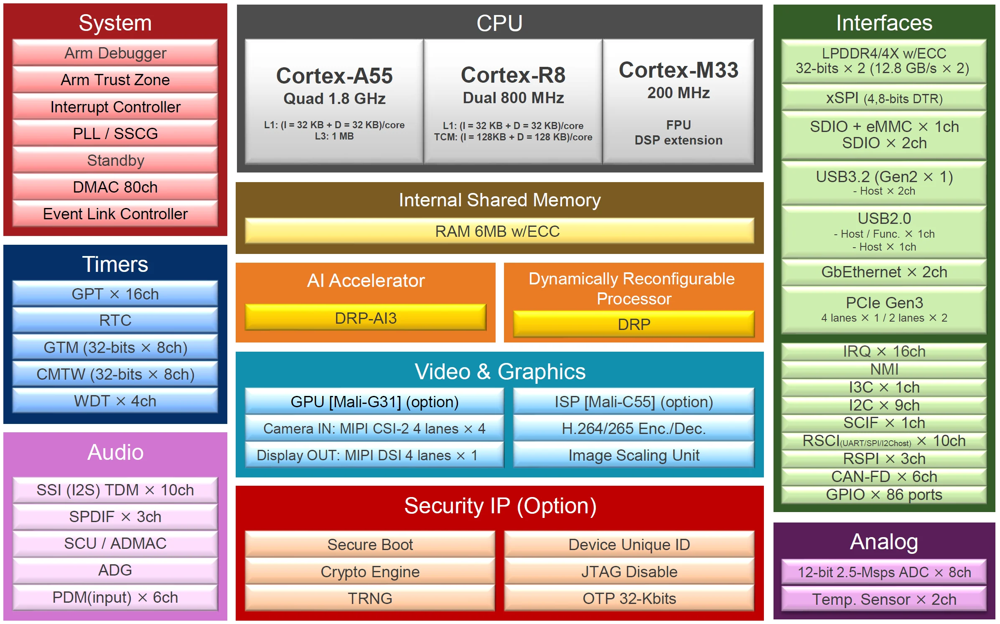

==============
Renesas RZ/V2H
==============

The RZ/V2H is a Renesas AI-accelerated multicore MPU built around a
heterogeneous set of Arm cores: dual Cortex-A55 (application cores) plus
dual Cortex-R8 (real-time cores), alongside a DSP and an AI-MAC (DRP-AI3)
accelerator.

Supported MCUs
==============

The following list includes MCUs from the RZ/V2H series and indicates
whether they are supported in NuttX:

=============  ======= ================
MCU            Support Note
=============  ======= ================
R9A09G057      Yes     CR8_0 core only
=============  ======= ================

Peripheral Support
==================

The following list indicates peripherals supported in NuttX on the CR8_0
core:

==========  =======  ============================================================
Peripheral  Support  Notes
==========  =======  ============================================================
CLOCK       Yes      BSP clock tree init (PLL), internal use only
GIC         Yes      Interrupt controller init (CPU0 + per-CPU)
MPU         Yes      Static PMSAv7 region table (ITCM/DTCM/SRAM/code)
TIMER       Yes      MPCore Private Timer used as the system tick source
SCI         Yes      Interrupt-driven SCI asynchronous UART on channels 0-9
SPI         Yes      Interrupt-driven SPI-B on channels 0-2
GPIO        Yes      Basic operations (config/read/write), no interrupt support
RIIC I2C    Yes      Interrupt-driven RIIC master on channels 0-8
SCI I2C     Yes      Interrupt-driven SCI simple I2C master on channels 0-9
ADC         Yes      ADC-E unit 0 with 8 analog inputs and group-A scans
RTC         Yes      Calendar, one-shot alarm, periodic wakeup, system clock.
PWM         Yes      GPT (General PWM Timer) PWM on channels 0-15
QSPI        Yes      xSPI controller in QSPI mode, manual-command transfers only
OpenAMP     Yes      RPTUN/RPMsg transport using shared memory and MHU-B (Mailbox)
CAN         Yes      CAN-FD on channels 0-5
==========  =======  ============================================================

CLOCK
-----

``rzv2h_clockconfig()`` calls into ``bsp_clock_init()`` from the vendored
Renesas FSP BSP to program the PLL and clock tree. It is invoked once
during boot and is not user-configurable through Kconfig.

GIC
---

The Generic Interrupt Controller is brought up by ``up_irqinitialize()``,
using NuttX's common ARM GIC support: CPU0-only initialization followed by
per-CPU initialization.

MPU
---

A static PMSAv7 region table protects the CR8_0 memory map (ITCM, DTCM,
SRAM and the executable code window). Regions are set up once at boot and
are not reconfigurable at runtime.

TIMER
-----

The Arm MPCore Private Timer is used as the system tick source, clocked
from the BSP clock tree and reloaded to match ``CLK_TCK``.

SCI
---

The Serial Communication Interface (SCI) provides multiple serial
communication modes. NuttX currently supports interrupt-driven UART operation
on channels 0 through 9 through the SCI lower-half driver.
``CONFIG_RZV2H_UART_SCI`` enables the driver and
``CONFIG_RZV2H_SCI_UARTn`` selects each required channel. The standard
``CONFIG_SCIn_*`` options configure the channel and select the console.

The driver supports early console output and registers the selected
console as ``/dev/console`` and ``/dev/ttyS0``. Other enabled channels are
registered in ascending channel order.

Runtime baud-rate changes are supported through the standard termios
``TCGETS`` and ``TCSETS`` operations.

Hardware flow control and DMA are not implemented yet.

An SCI channel can be used for UART or for simple I2C (see SCI I2C
below), but not for both at once.

GPIO
----

The GPIO driver provides fundamental support for pin configuration, read,
and write operations. GPIO interrupt support is currently unavailable.

RTC
---

The RTC driver provides a calendar clock (date and time) through the
standard NuttX RTC lower-half. ``CONFIG_RZV2H_RTC`` enables it and requires
``CONFIG_RTC``, ``CONFIG_RTC_DATETIME``, ``CONFIG_RTC_DRIVER`` and
``CONFIG_RTC_ARCH``. It exposes ``/dev/rtc0`` and seeds the NuttX system
clock at boot. The supported calendar range is 2000-2099. If the RTC has
never been set, the system clock falls back to the build-time default date.

``CONFIG_RTC_ALARM`` adds a single one-shot alarm (``CONFIG_RTC_NALARMS``
must be 1) supporting absolute, relative, read-back and cancel operations.
``CONFIG_RTC_PERIODIC`` adds a periodic wakeup at rates from `1/128s` to `2s`.

INTC SEL (Interrupt Select) Lines
---------------------------------

The CR8 core's INTC provides a
pool of 127 programmable "SEL" lines (SEL0-SEL126, GIC IRQ numbers
353-479) whose peripheral event mapping is set through the INTC INTSEL
registers. Peripheral drivers that need one of these programmable lines
request a specific SEL number and event through
``rzv2h_intsel_connect_event()``.

Default SEL IDs
^^^^^^^^^^^^^^^

The 127-line SEL pool (SEL0-SEL126, IRQ 353-479) is conventionally
partitioned by module, allocated from the top of the range downward:

========  ==================  ================================
Module    Count                IRQ range (>= 353)
========  ==================  ================================
TINT      32 (tint0-tint31)    479-448
RIIC I2C  9 (riic0-riic8)      447-430 (txi/rxi only)
ADC       1 (adc0)             429
SPI       3 (spi0-spi2)        428-423 (txi/rxi only)
CAN       6 (can0-can5)        419-400 (gerr/grecc, rec/trx/err)
========  ==================  ================================

Changing interrupt-select IDs (RIIC2 as an example)
^^^^^^^^^^^^^^^^^^^^^^^^^^^^^^^^^^^^^^^^^^^^^^^^^^^

When the default interrupt-select ID needs to change, e.g. to move
RIIC2 off its default TXI/RXI SEL IDs (443/442) and onto SEL IDs
397/396 instead:

#. Run ``make menuconfig`` and navigate to
   ``System Type -> RZ/V2H Configuration Options -> RIIC I2C support ->
   RIIC 2``.
#. Set ``RIIC2 TXI interrupt-select (SEL) IRQ number`` to ``397``.
#. Set ``RIIC2 RXI interrupt-select (SEL) IRQ number`` to ``396``.

Rebuild and reflash after changing either option so the new INTSEL
values are picked up.

OpenAMP
-------

NuttX on CR8_0 can communicate with Linux on CA55 through the generic
RPTUN/OpenAMP RPMsg stack. Linux is the VirtIO master and NuttX is the
device. Shared memory holds the resource table, vrings and message
buffers; the RZ/V2H lower half uses MHU-B (Mailbox) for notifications.

``CONFIG_RZV2H_RPTUN`` enables the transport. The current EVK and RDK
``nsh-openamp`` configurations select channel 1 and provide the
``rpmsg-service-1`` echo endpoint for a compatible Renesas Multi-OS
v3.3.0 Linux peer. NuttX activates one channel at a time, and the
Linux peer must use matching memory reservations and mailbox routing.

Boot and test procedures are board-specific. The EVK and RDK configuration
generates single uboot images for U-Boot. Neither documented flow uses Linux
kernel RemoteProc to load NuttX. See the
:doc:`EVK board guide </platforms/arm/rzv2h/boards/rzv2h-evk/index>`
and :doc:`RDK board guide </platforms/arm/rzv2h/boards/rzv2h-rdk/index>`
for configuration, boot, Linux peer requirements and RPMsg testing.

RIIC I2C
--------

The RIIC driver provides interrupt-driven I2C master
operation on channels 0 through 8.

``CONFIG_RZV2H_RIIC_I2C`` enables the driver and
``CONFIG_RZV2H_RIICn`` selects each required channel. Each channel has
independent Kconfig options for bus bitrate, SCL rise/fall times, duty
cycle, noise filter stages, TXI/RXI interrupt-select (SEL) IRQ numbers,
and interrupt priority.

I2C bus reset recovery (``CONFIG_I2C_RESET``) is supported. The driver
bit-bangs SCL to clock out stuck slaves, then generates a START+STOP
sequence to reset slave state machines.

SCI I2C
-------

The SCI I2C driver provides interrupt-driven I2C master operation (SCI simple
I2C mode, up to 400 kHz) on channels 0 through 9.

``CONFIG_RZV2H_SCI_I2C`` enables the driver and
``CONFIG_RZV2H_SCI_I2Cn`` selects each required channel; the channel's
SCI UART must be disabled. Each channel has independent Kconfig options
for bus bitrate, SDA output delay, noise filter clock, bit-rate modulation,
and interrupt priority. Channel ``n`` is registered as
``/dev/i2c<CONFIG_RZV2H_SCI_I2C_BUS_OFFSET + n>``.

I2C bus reset recovery (``CONFIG_I2C_RESET``) is supported, using the same
method as RIIC I2C.

ADC
---

The ADC-E driver supports the single RZ/V2H ADC0 unit and provides eight
dedicated analog inputs, ``ANI000`` through ``ANI007``.
``CONFIG_RZV2H_ADC`` enables the ADC-E driver. The following functions are
currently supported:

* 8-bit or 12-bit conversion results
* Polling or scan-end interrupt
* Software-triggered group-A scans
* Asynchronous external ``ADTRG`` input triggering in interrupt mode
* Configurable addition or averaging of results
* Clear-after-read operation
* Window A comparison and event status

``ANIOC_TRIGGER`` starts a software-triggered scan or arms the external
trigger, depending on the selected Kconfig trigger source.
``ANIOC_GET_NCHANNELS`` reports the number of configured inputs. Window A
builds also provide ``ANIOC_RZV2H_WINDOW_A_STATUS``.

The scan-end request is connected to a programmable INTC SEL line.
Currently set ADC's scan-end interrupt-select IRQ number to ``429`` (SEL76).

Group-B and group-C scans, GPT/ELC trigger routing, DMA delivery, and Window B
comparison are not currently supported.

SPI
---

The interrupt-driven SPI lower half supports SPI-B channels 0 through 2.  Each
channel can be enabled independently and configured at build time as either a
master or a slave using the standard NuttX SPI frameworks.

Master channels use ``struct spi_dev_s`` and support runtime frequency,
CPOL/CPHA mode, and 4- to 32-bit word-width configuration.  Slave channels use
``struct spi_slave_ctrlr_s`` and fixed-length transactions.  Both 3-wire
clock-synchronous operation without SSL and 4-wire operation with native
hardware SSL are supported.  RXI and TXI are routed through INTSEL, while TEI
and ERI use fixed SPI-B interrupts.

The RZ/V2H-EVK ``nsh-spi`` configuration provides SPI1 master loopback and
SPI0-master-to-SPI2-slave validation.  See the board documentation for wiring
and commands.

PWM
---

The RZ/V2H use the pulsed output control
implemented using the GPT (General PWM Timer). The driver supports PWM with
configurable frequency and duty cycle on channels 0 through 15.

``CONFIG_RZV2H_GPT_PWM`` enables the GPT PWM driver. Each channel is
individually selectable via ``CONFIG_RZV2H_GPTn_PWM``.
The output pin (GTIOCA or GTIOCB) for each channel is defined in the
board's ``board.h`` (``BOARD_GPTn_GTIOC_GPIO`` and ``BOARD_GPTn_USE_GTIOCA``).

QSPI
----

``rzv2h_qspi.c`` implements the standard NuttX ``struct qspi_dev_s``
interface (``arch/arm/src/rzv2h/rzv2h_qspi.c``) on top of the Renesas FSP
xSPI-QSPI HAL (``r_xspi_qspi``). It is intended to drive a SPI NOR flash
device wired to the xSPI controller, using the NuttX QSPI-based MTD flash
drivers (``n25qxxx``, ``mx25rxx``, ``w25qxxxjv``, ``gd25``, ``gd55``,
``s25fl1``).

Commands and memory reads/writes are issued through
``R_XSPI_QSPI_DirectTransfer()`` (manual-command mode); each transaction
moves at most 8 bytes, so larger transfers are split into a sequence of
transactions by the driver. There is no XIP (execute-in-place,
memory-mapped) support and no DMA: all data moves through the CPU, so
throughput is limited compared to a memory-mapped or DMA-driven transfer.

Protocol support
^^^^^^^^^^^^^^^^

The ``n25qxxx`` MTD driver always requests Quad I/O Fast Read (``0xEB``).
``rzv2h_qspi_memory()`` sends that read on the wire in whichever protocol
is selected by the ``CONFIG_RZV2H_QSPI_N25QXXX_PROTOCOL_*`` choice.
Program, erase, and status/configuration-register commands always use
``1S-1S-1S``, whatever read protocol is selected.

.. list-table::
   :header-rows: 1

   * - Protocol
     - Kconfig option
     - Read command
     - Status
   * - ``1S-1S-1S``
     - ``CONFIG_RZV2H_QSPI_N25QXXX_PROTOCOL_1S1S1S``
     - READ (``0x03``)
     - Supported
   * - ``1S-2S-2S``
     - ``CONFIG_RZV2H_QSPI_N25QXXX_PROTOCOL_1S2S2S``
     - Dual I/O Fast Read (``0xBB``)
     - Supported
   * - ``1S-4S-4S``
     - ``CONFIG_RZV2H_QSPI_N25QXXX_PROTOCOL_1S4S4S``
     - Quad I/O Fast Read (``0xEB``)
     - Supported (**default**)
   * - ``4S-4S-4S``
     - ``CONFIG_RZV2H_QSPI_N25QXXX_PROTOCOL_4S4S4S``
     - FAST READ (``0x0B``) in persistent Quad SPI mode (``0x35``/``0xF5``)
     - Supported
   * - ``4S-4D-4D``
     - ``CONFIG_RZV2H_QSPI_N25QXXX_PROTOCOL_4S4D4D``
     - DTR FAST READ (``0x0D``) in persistent Quad SPI mode
     - Needs a board that connects ``XSPI0_DS`` to the flash (see below)
   * - ``8D-8D-8D``
     - none
     - none
     - Not supported

``2S-2S-2S`` has no Kconfig read option. The driver still sends it for
commands that set the dual-instruction flags (``QSPICMD_IDUAL`` or
``QSPIMEM_IDUAL``).

DDR protocols (``4S-4D-4D`` and ``8D-8D-8D``) sample read data with the
``XSPI0_DS`` strobe. The hardware manual states: "DDR access without
XSPI0_DS is not supported". A board must connect ``XSPI0_DS`` to a flash
that drives it before ``4S-4D-4D`` can work.

``8D-8D-8D`` is not supported for four reasons:

- The FSP xSPI-QSPI HAL rejects it: ``R_XSPI_QSPI_SpiProtocolSet()``
  returns ``FSP_ERR_INVALID_ARGUMENT``. The ``SOPI`` and ``DOPI`` modes
  are rejected the same way.
- It needs ``XSPI0_IO4``-``XSPI0_IO7`` and ``XSPI0_DS`` connected to an
  octal flash.
- The Quad SPI NOR flash on the RZV2H boards has only 4 data lines.
- The generic NuttX QSPI interface (``include/nuttx/spi/qspi.h``) has no
  flags for octal or DDR transfers.

The xSPI serial clock is derived from a dedicated CPG divider that only
feeds this peripheral (four ratios: source clock divided by 2, 4, 8, or
16); ``rzv2h_qspi_setfrequency()`` picks the closest ratio that does not
exceed the requested frequency.

See :doc:`the RZV2H-EVK board documentation <boards/rzv2h-evk/index>` for
board-level bring-up, partitioning, and configuration details.

CAN
------

The CAN-FD driver supports CAN FD operation on channels 0 through 5.

``CONFIG_RZV2H_CANFD`` enables the driver and ``CONFIG_RZV2H_CANFDn``
selects each required channel. Each channel has independent Kconfig
options for the nominal and data bit rates (computed from the rates and
sample point, or set manually), delay compensation, the receive FIFO,
the number of TX message buffers, channel error interrupts, REC/TRX/ERR
interrupt-select (SEL) IRQ numbers, and interrupt priority.

Error reporting (``CONFIG_CAN_ERRORS``) is supported.

With ``CONFIG_CAN_LOOPBACK``, each channel enters internal or external
loopback mode when opened, as selected by
``CONFIG_RZV2H_CANFD_LOOPBACK_INTERNAL`` or
``CONFIG_RZV2H_CANFD_LOOPBACK_EXTERNAL``.

With ``CONFIG_RZV2H_CANFD_SOCKET``, the channels are SocketCAN network
interfaces (``can0`` to ``can5``) instead of character devices.

Supported Boards
================

.. toctree::
   :glob:
   :maxdepth: 1

   boards/*/*
